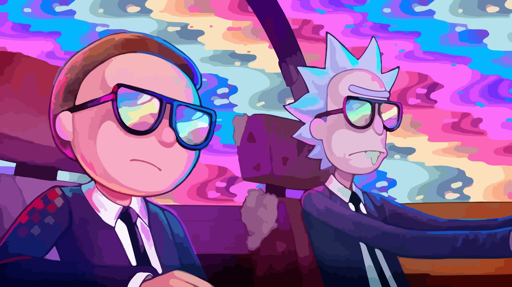

# Omarchy Rick and Morty Theme

A lab-dark [Omarchy](https://omarchy.org) theme with portal-green chrome, Morty yellow, and cyan energy. For Omarchy Quattro.



## Install

Paste these two commands into a terminal:

```bash
omarchy theme install https://github.com/MattsMacsGit/omarchy-rick-and-morty-theme
bash ~/.config/omarchy/themes/rick-and-morty/install.sh
```

The first command gets you the colours, wallpapers and icons. The second one turns on everything else:

- **Portal window effects:** green glow, frosted bar and menus, and windows that pop in like they came through a portal.
- **Live portal wallpapers:** the videos play when your desktop is empty and pause when windows are open.
- **Credits-style clock:** the bar clock in cyan Short Stack, like the show's end credits.
- **Rick and Morty screensaver:** OMARCHY drawn in the show's title lettering.

The clock and screensaver only change while this theme is active. Switch themes and they go back to normal.

### What the install script does

Each step is safe to run again.

1. Deletes the theme's `.git` folder. Omarchy skips `hyprland.lua` (the window effects) in any theme that still has one. The catch is that `omarchy theme update` stops working for this theme, so to update, delete the theme folder and run the two commands again.
2. Installs the Short Stack font to `~/.local/share/fonts`.
3. Clones Omarchy's clock widget (`omarchy plugin clone omarchy.clock`) and patches it to read `clock-font` and `clock-color` from the current theme.
4. Installs a theme-switch hook that swaps in `screensaver.txt` and puts your own screensaver back on other themes.
5. Creates `~/.config/owe/config.toml` so the video wallpaper pauses behind windows. If you already have that file, it's left alone.
6. Applies the theme and restarts the shell.

## Palette

| Role | Hex |
| --- | --- |
| Background | `#090215` |
| Dark background | `#06010f` |
| Darker background | `#030008` |
| Lighter background | `#1a1230` |
| Foreground | `#F4E7C3` |
| Accent | `#97ce4c` |
| Cyan | `#7fede1` |
| Yellow | `#ffe14a` |
| Selection | `#1c1430` |
| Muted | `#6e6480` |

The full ANSI palette is in [`colors.toml`](colors.toml). Icons are `Yaru-olive`, and the keyboard RGB is portal green.

## Backgrounds

`backgrounds/` has three stills and two portal videos. Press `Super + Ctrl + Space` to cycle through them.

## Fonts

- **Clock:** [Short Stack](https://fonts.google.com/specimen/Short+Stack) by Sorkin Type, under the SIL Open Font License ([`fonts/OFL.txt`](fonts/OFL.txt)). It's a close free match for the hand-lettered end credits.
- **Screensaver:** drawn with "Get Schwifty", a fan-made version of the show's logo lettering. The art comes pre-rendered in `screensaver.txt`, so the font itself isn't included or needed.

## Fan work

Rick and Morty is owned by Cartoon Network / Adult Swim. This is unofficial fan work, not affiliated with or endorsed by the rights holders.
